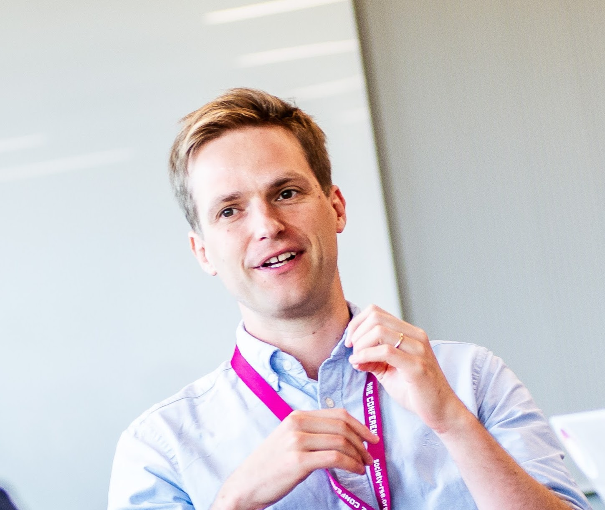
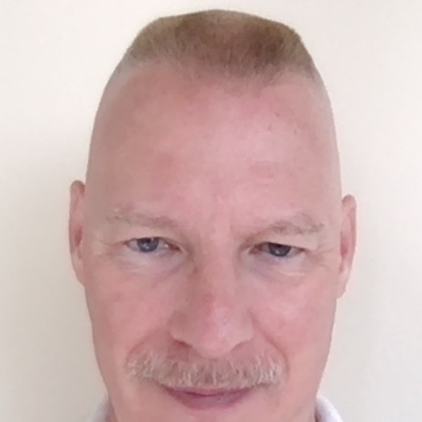
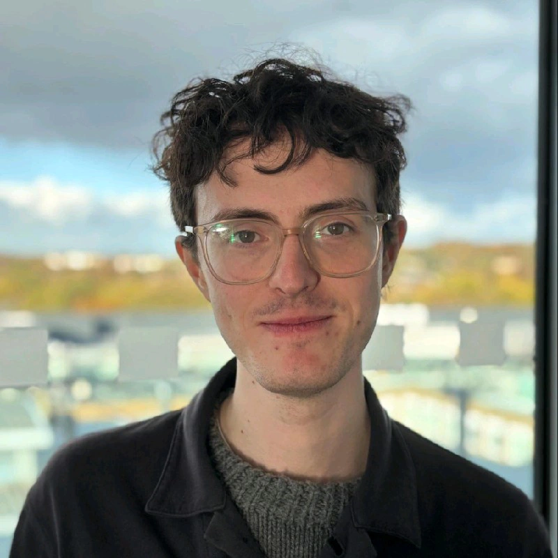
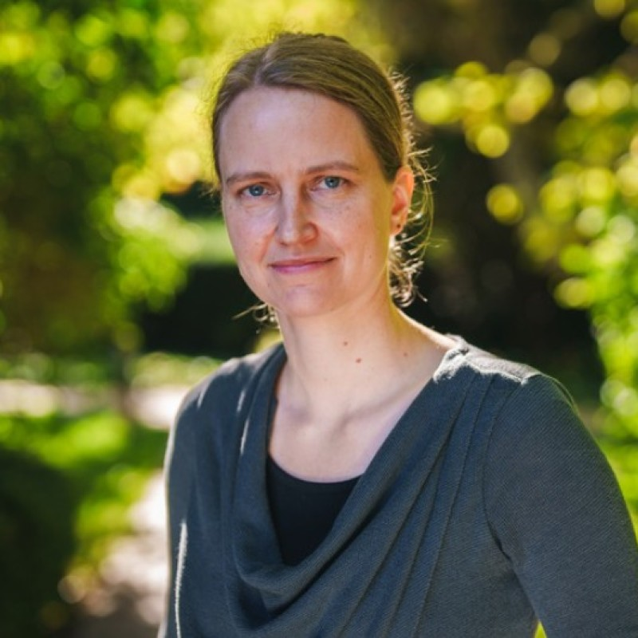
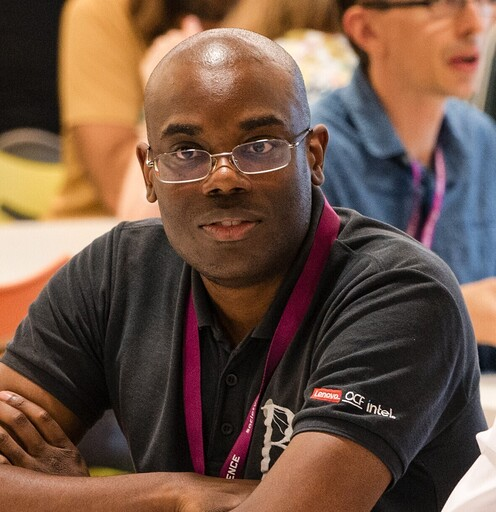
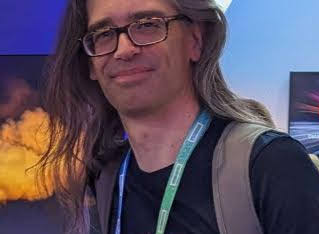
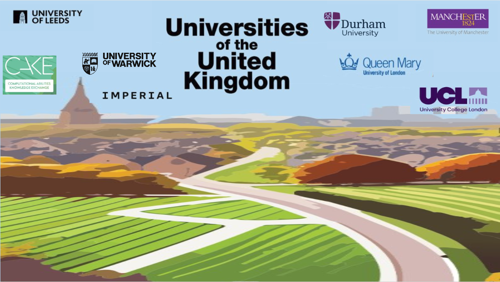

# Who am I?

- I am a principal research software engineer at UCL Advanced Research Computing Centre (ARC)
- We are a central team of full-time research software engineers, research infrastructure developers, data scientists, data stewards and PRISMs supporting research across UCL
- We are a hybrid academic and service department
- I'm also a member of the HPC RSE SIG

# HPC RSEs in the UK

- UK has a large and active RSE community
- There are many RSEs working in HPC, but they are often isolated
- Different roles from development of research software to support of HPC facilities
- A few large central teams, and many small teams or individuals
- Many efforts over the last 10+ years to build community and support HPC RSEs

# HPC RSE SIG

::: {layout="[70,15,15]"}

- HPC RSE SIG was formed in 2024 to support HPC RSEs across the UK
- Governed by a steering group of volunteers from across the UK
- Organises networking events, workshops and informal mentorship for HPC RSEs
- Maintains contacts with other similar groups in the UK

:::

# Activities in 2025-2026

- Two regular face to face meetings per year in RSECon and Durham HPC Days
  - Talks, Panels, Discussions, Networking
- Ad hoc virtual meetings to discuss topics of interest
- Publishes news and blog on https://socrse.github.io/hpc-rse-sig/
- International collaboration is welcome!

# We are at Booth #4656

